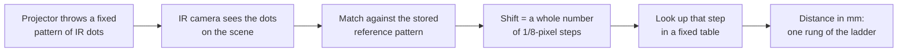

# Kinect v1 as a measuring instrument

**Our Xbox 360 Kinect cannot report just any distance: between 1 and 4 metres it has exactly 259 possible answers, and a formula its chip maker published lists every one of them, with nothing fitted.**

 [](https://github.com/Hashirama1337s)

Moki & Julio · version 2.1 (2026-09-27) · GitHub only (no archive DOI)

**Read** [TECHNICAL.md](TECHNICAL.md) · **Open questions** [OPEN_QUESTIONS.md](OPEN_QUESTIONS.md) · **Changes** [CHANGES_v2.1.md](CHANGES_v2.1.md)

## In plain words

The Kinect is a depth camera made for the Xbox 360. Point it at a room and every pixel comes back with a distance in
millimetres. We took one unit and measured it the way a lab measures an instrument: every claim has the script that
produced it, its number and its status.

The first question was plain. How many different distances can it actually report? If it measured smoothly, the answer
would be "as many as there are millimetres". It is not. Between 1 and 4 m this unit can report **259** values, and in the
software's 0.8-4 m window, **345**. In the standard depth stream, no capture, warm or cold, has produced a value outside
one published table.

A picture that helps: **a ladder leaning into the room.** The sensor can only stand on a rung, never between two. At 1 m
the rungs are about 3 mm apart; at 3 m they are about 26 mm apart. So far objects get coarser readings.
Where the picture breaks: a real ladder has evenly spaced rungs, and this one's rungs are evenly spaced in *one over the
distance*, not in distance. And a pixel does not stand still on its rung: noise can make it hop to the next one.

What else we found. Microsoft's software and the open-source drivers use the same table but sit **half a rung apart**.
That offers a mechanism for a driver difference first reported in 2015 (it matches the gap seen on this model). "The noise" is really three kinds of pixel, and about **1 %**
of them carry **95 %** of the noise. The sensor drifts by **+8.2 mm** in its first 6 minutes of warming up at 2.5 m.

Why it matters: if you measure with a Kinect, you now know which numbers are possible, which pixels to distrust, and why
averaging many frames helps less than you would hope. The count itself was first reported in 2014 (credited below); what
we add is the exact formula match, the driver phase, the noise split and a map of what this hardware can and cannot do.

## At a glance

*The exact claims, for specialists. Terms are explained in "How it works" and "Words you will meet".*

- **Lattice closure (HOLDS, a verification of a public formula).** The SDK 1.8 millimetre output equals PrimeSense's
  shift-to-depth table at phase 0 with floor rounding: all 266 observed values (863-3975 mm) reproduced, zero extras, no
  fitted parameter (`lattice_closure.py`). The open drivers sit at phase 0.5; the value sets interleave by half a rung.
- **Noise populations (HOLDS at ~3 m; range-dependent).** Median 2.62 mm, RMS 38.06 mm, worst 1 % = 94.9 % of variance at a
  median range of 2.9 m. Range alone predicts per-pixel sigma as z^1.80 (R² 0.574).
- **Temporal correlation (QUALIFIED).** Raw integrated correlation time 2.74 s, mostly slow drift; detrended autocorrelation ~0.15 at
  lags 1-8, gone by ~3 s. Averaging gain ~1.8x at N = 180 frames, not the square root of N.
- **The SDK calibration blob** (documented calls only): 12,604 bytes containing the 118-byte PrimeSense registration
  block; used for depth-to-colour registration only. SDK 3-D coordinates use one nominal pinhole, f = 571.2653 px.
- **Capabilities on an Xbox 360 unit:** 13 of 28 stream/resolution pairs open; near mode, projector-off and colour-camera
  settings refused with `0x8301000F`; 10-bit IR at 640x480; a GRBG Bayer mosaic at 1280x960 delivering 10.22 fps;
  4-channel 16 kHz microphones.

Every row, with its status and script, is in [TECHNICAL.md](TECHNICAL.md) (the full previous README). Open, measurable
follow-ups with pass/fail bars are in [OPEN_QUESTIONS.md](OPEN_QUESTIONS.md).

## What we do not claim

- One Xbox 360 unit (model 1414), one host, one driver stack, one operator. Not independently replicated.
- The count is not ours first: the Byte Kitchen blog (M. Drossaers, 2014) reported 345 values in the SDK's default range.
  The quantisation law itself is textbook (Khoshelham & Oude Elberink 2012). Warm-up drift is published prior art.
- Withdrawn in v2.1: "a cold sensor manufactures extra levels" (it was scene coverage) and a "-3.4 %" scale error (the
  reference box's tape numbers were wrong). Full list: [Corrections](TECHNICAL.md#corrections-read-first).
- Lateral scale: +0.45 % to +1.74 % against a factory-sized envelope, which is NO VERDICT by the rule fixed in advance.
- Open: the extended-depth values that seem to wrap modulo 65,536; whether the Bayer mosaic is linear; what sets the IR
  ceiling. The 73 % keep-rate is a flat-target number, never a sensor property.

## How it works

### The idea

The Kinect does not time light. It projects a fixed pattern of infrared dots, looks at them with an infrared camera, and
compares small windows of what it sees with a stored picture of the same pattern. A nearer surface shifts the dots
sideways. The shift is stored as a **whole number** of eighth-of-a-pixel steps, so only certain distances can come out.



### A worked example

Rung number *n* gives the distance

    z = floor( 1 / (1/1200 - n * D) )   millimetres,   with D = 0.1042 / 36000 per mm

PrimeSense, the company that made the chip, published the constants in its driver code: a zero-plane distance of 120, a
pixel-size constant of 0.1042, a coefficient of 4 and a shift scale of 10. Together they put rung 0 at 1200 mm. The 120
and the 0.1042 are also stored in this unit's own calibration data.

A worked example. Rung 0 is the reference plane, 1200 mm. Rung +1 gives 1204 mm and rung -1 gives 1195 mm. Our capture
contains exactly 1195, 1200 and 1204, and nothing in between. At the far end the rungs we saw were 3885, 3930 and
3975 mm: 45 mm apart. Run the formula over 1-4 m and you get 259 rungs; over 0.8-4 m, 345. Against 266 values this
unit produced (863-3975 mm), the formula with nothing adjusted reproduces every one and predicts no extras.

The half-rung puzzle. The open-source drivers (libfreenect, OpenNI) subtract a constant 0.375 that moves their ladder by
half a rung. So near 1 m Microsoft's software reports 998 / 1001 / 1004 mm, while OpenNI reports 1000 / 1003 / 1006 mm.

The three kinds of noisy pixel (measured at about 3 m; the split changes with range). Watch each pixel over time:

- **pinned** (about half): stays within 1-3 mm, well below one rung;
- **dithering** (a quarter to a third): hops between two neighbouring rungs;
- **catastrophic** (about 1 %): edges, grazing angles, surfaces that swallow infrared. These carry 95 % of the variance.

That is why the typical pixel's noise (median **2.6 mm**) and the average noise (RMS **38 mm**) disagree so badly.
Throwing out pixels whose noise exceeds 10 mm kept about 73 % of a flat target and removed 99.4 % of the variance.

## Reproduce and reuse

Questions this lets you answer:

- Is a depth change in my data real, or one rung step? (At 1 m a step is about 3 mm; at 3 m about 26 mm.)
- Which of my pixels can I trust?
- Did this depth file come from Microsoft's SDK or from libfreenect / OpenNI? (Their value sets sit half a rung apart.
  Limit: the OpenNI side was checked on an Xtion-class recording, never on an OpenNI recording of a Kinect v1.)
- Which streams, resolutions and features does my own Kinect really open?

**1. Check the main claim without a Kinect** (any computer, Python 3 with numpy):

```
git clone https://github.com/Hashirama1337s/kinect-v1-depth-levels
cd kinect-v1-depth-levels
python -c "import json,numpy as np; np.save('depth_lattice.npy', np.array(json.load(open('depth_lattice_values.json'))['values_mm']))"
python lattice_closure.py
```

You should see:

```
formula D (1/D = 345,489.4 mm): best phase 0.0000 (floor) -> reproduces 100.0 % of 266 observed values, extras 0.0 %
VERDICT: EXACT CLOSURE
implied depth focal length at 640 px from the formula constants: 120 / (2 x 0.1042) = 575.82 px (SDK nominal 571.26)
```

**2. Measure your own Kinect.** You need Windows, the Kinect for Windows SDK 1.8 (driver), the sensor on a **root-hub USB
port** (not behind an external hub), and Python 3 with numpy and scipy (the viewer also uses pillow and matplotlib). Run
each script from its own folder.

```
python first_contact.py     # 5-frame smoke test
python viewer.py            # live panel: key 6 = LATTICE (each band is one rung), key 4 = CONFIDENCE
python quantisation.py      # 200 frames of your scene; writes your own depth_lattice.npy
python lattice_closure.py   # does your unit sit on the same table?
python capmap.py            # which (image type, resolution) pairs open on your unit
```

Two traps that cost us time. The SDK's depth pixel holds millimetres in bits 3-15, so always shift right by 3 (`raw >> 3`)
or every number is eight times too large. And if the camera will not start while the motor and audio do, move the sensor
to a root-hub port before suspecting the power supply.

**3. Reuse the table in your own code.** No Kinect needed; standard library only.

```python
import math

D = 0.1042 / 36000          # one rung, in 1/mm (PrimeSense constants)

def rung_mm(n):
    """Millimetre value the SDK reports on rung n (rung 0 is the 1200 mm reference plane)."""
    return math.floor(1 / (1 / 1200 - n * D))

def rungs_between(lo_mm, hi_mm):
    """Every value the SDK can report with lo_mm <= z <= hi_mm."""
    n_lo = math.ceil((1 / 1200 - 1 / lo_mm) / D) - 2
    n_hi = math.floor((1 / 1200 - 1 / hi_mm) / D) + 2
    return sorted({z for z in map(rung_mm, range(n_lo, n_hi + 1)) if lo_mm <= z <= hi_mm})

print(rung_mm(-1), rung_mm(0), rung_mm(1))   # 1195 1200 1204
print(len(rungs_between(1000, 4000)))        # 259
print(len(rungs_between(800, 4000)))         # 345
```

This is the Microsoft SDK's ladder (phase 0). For a simple pixel filter, drop pixels whose temporal sigma exceeds 10 mm.
We kept 38-48 % of our real rooms this way, against 73 % of a flat target; the rate depends on the scene.

## Words you will meet

- **Structured light** - measuring depth by projecting a known pattern and seeing how it shifts.
- **Disparity** - that sideways shift of the pattern; the sensor stores it in whole 1/8-pixel steps.
- **Rung / lattice** - the fixed set of distances the sensor can report.
- **Phase** - where a ladder's rungs start; two ladders with the same spacing but phase 0 and 0.5 interleave.
- **SDK** - Microsoft's Kinect for Windows software kit (here version 1.8). **libfreenect / OpenNI** - open-source drivers.
- **Temporal sigma** - how much one pixel's reading wobbles over time.
- **Median vs RMS** - the typical value vs an average that big outliers can dominate.
- **Sealed rule** - a pass/fail bar written down before looking at the data; NO VERDICT means the bar did not decide.
- **Root-hub port** - a USB socket wired directly to the computer's controller, not through an extra hub.

## How to cite

```
Moki & Julio (2026). Kinect v1 as a measuring instrument - the depth lattice, the three noise populations, and the Xbox 360 sensor's capabilities. Version 2.1. https://github.com/Hashirama1337s/kinect-v1-depth-levels
```

There is no archive DOI. Machine-readable: [CITATION.cff](CITATION.cff). Code: MIT ([LICENSE](LICENSE)).

## Related projects

- [moki-julio-wifi-ris-cell](https://github.com/Hashirama1337s/moki-julio-wifi-ris-cell): a one-switch, three-band Wi-Fi reflector cell, designed in simulation only
- All projects: [the Moki & Julio lab map](https://github.com/Hashirama1337s)

---

*Prepared with AI assistance; what was checked, and by what, is stated above.*
